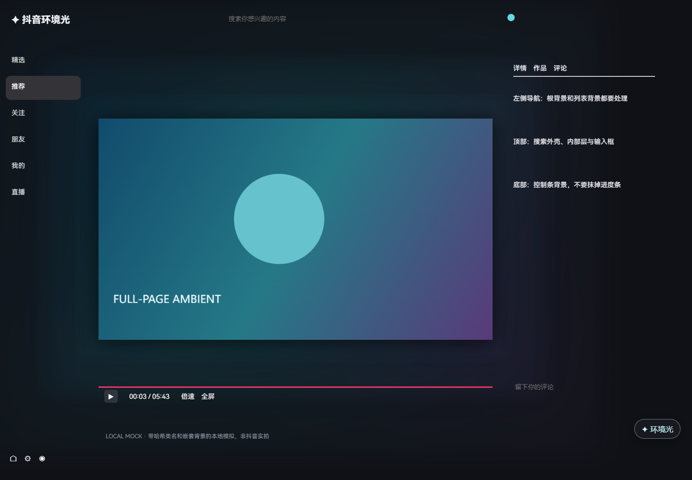
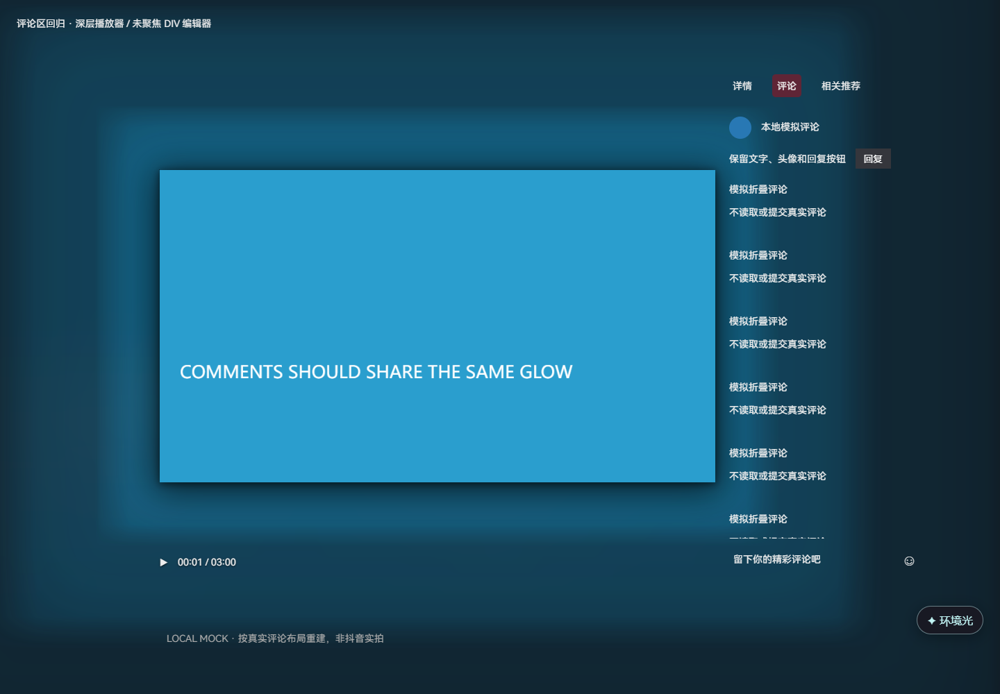
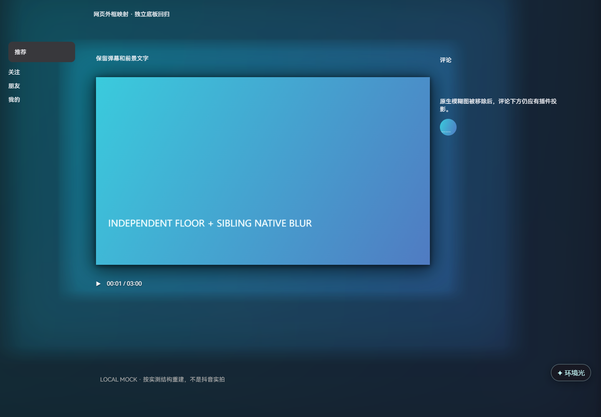

# 抖音环境光 0.5.1 · 全区域沉浸适配测试版

参考 [bilibili-ambilight](https://github.com/iceorange-dev/bilibili-ambilight) 和原作 [WesselKroos/youtube-ambilight](https://github.com/WesselKroos/youtube-ambilight) 的分类组织，提供 86 个本地持久设置及预设（另有内部迁移版本字段）。**这是面向抖音的独立实现，不是原项目引擎或全部功能的一比一移植。** 具体差异见同目录《功能对照.md》。

## 下载

- [v0.5.1 测试包与源码](https://github.com/ADVICEsama/douyin-ambilight/releases/tag/v0.5.1)
- [更新记录](CHANGELOG.md) · [验证范围](验证报告.md) · [与原作差异](功能对照.md)

当前仓库为私有仓库，下载需要已获访问权限的 GitHub 登录。未配置脚本自动更新地址，不需要任何外部账号来运行插件本身。



## 0.5.1 评论区修复

- 当前播放器会多插入若干包装层，0.5.0 固定向上找 4 层会漏掉评论卡片；改为识别真实卡片标记并在当前视频卡片内有界查找。
- 评论面板的外壳、顶部短标签栏、列表背景及未聚焦的 DIV 占位编辑器一起融合；不是只有 textarea 才适配。
- 保留选中标签、文字、头像和回复按钮。输入区开关与侧栏开关独立，整块面板被重新挂载后会重新适配。
- 已在用户当前 Zen 安装 0.5.1 XPI 并刷新、打开真实评论区，核对面板/标签栏/输入区均透明，截图可见连续环境光。没有提交真实评论、修改签名政策或开启隐私窗口权限。



## 0.5 与 0.4 的实际区别

0.4 主要补充导航、搜索、控制栏等内部背景的透明化，但真实页面仍有两处遮挡，因此定位成功也不代表外框已经照亮：

- 独立的全页暗色底板是内容树的空兄弟节点，不是 video 的父节点；它会盖住背景层中的环境光和阴影。
- 原生模糊图位于播放器外的当前视频卡片中，覆盖视频和评论；其容器还包含一块黑色承托层。只藏图片会留下黑板。

0.5 新增有界的空底板识别，以及当前卡片的原生模糊/黑底组合层识别。新增“网页外框与底板融入背景”开关；原生背景仍受原来的隐藏开关控制。高层弹窗、按钮、头像、弹幕不作为底板隐藏。

视频背影改为近边接触阴影 + 外围柔影，不靠把整个视频容器涂黑。网站覆盖同一节点的背景样式时也会重新适配，关闭插件则还原网站最新值。

本轮通过 Zen 开发者工具读取了实际结构，并临时验证清除底板能照亮导航/顶栏；临时修改已恢复。新增 9 项真实结构重建的像素回归，**模拟图不是抖音实拍，新包完整安装后的其他路线仍需验收**。



浏览器自身的标签侧栏、书签栏和标题栏不属于网页，插件不会改它们。

## 从旧版更新（Zen / Firefox 推荐）

1. 打开你已安装的 Tampermonkey / Violentmonkey，编辑原来的“抖音环境光”脚本。
2. 用文本编辑器打开 `douyin-ambilight-0.5.1.user.js`，复制全部内容，**在原脚本中全选替换并保存**。
3. 刷新抖音。不要同时启用新旧两份脚本，也不要同时开启扩展版与脚本版。
4. 设置中的“隐藏抖音自带模糊背景”默认开启。状态区应显示“已隐藏 N 个网站背景层”；N=0 表示该播放器结构未识别，不能算已处理成功。

沿用存储键；首次读取旧版设置时，在本地备份到 `douyin-ambilight-settings-v1-before-layout-v3`，再迁移合成方式、背影、背景融合和真实裁剪。原来的强度、扩散、模糊等自定义数值保留；旧默认 24 FPS 上限迁移为 60 FPS。脚本管理器正常保存的脚本不是临时附加组件，通常会在重启后保留；此轮未执行你个人浏览器的重启验收。本地版本没有自动更新地址。

首次使用：从官方扩展商店安装脚本管理器，在其中新建脚本，粘贴全部 `.user.js` 内容并保存即可。管理器自身权限由它独立管理。

## Chrome / Edge 扩展

解压 `douyin-ambilight-0.5.1-chrome.zip` 到固定目录。打开 `chrome://extensions` / `edge://extensions`，开发者模式 → 加载已解压扩展，选择包含 manifest.json 的目录。已有旧版则替换原目录文件、在扩展页重新加载，然后刷新抖音。不要删除已加载的目录。

## Zen / Firefox XPI

`douyin-ambilight-0.5.1-firefox-unsigned.xpi` **未签名，仅供开发测试**。可从 `about:debugging#/runtime/this-firefox` 临时载入；临时安装会在重启后消失，不能当成持久安装。Firefox 正式安装需要 Mozilla 签名，Zen 行为也受版本和配置影响。没有修改任何签名或安全设置，也没有替你发布、上传或签名。参见 [Mozilla 签名说明](https://extensionworkshop.com/documentation/publish/signing-and-distribution-overview/)。

## 11 个设置分类

| 分类 | 已连接的功能 |
|---|---|
| 设置 | 总开关、隐藏原生模糊、4 套预设、实测 FPS / 帧间隔 / 绘制耗时 / 黑边统计叠层 |
| 质量与性能 | Canvas2D / WebGL2、取样长边 64–256 px、12/24/30/60 FPS、视频回调 / 显示器 / 定时器同步、优先页面载入 |
| 顶栏 | 阴影大小和透明度、图片与背景不透明度 |
| 页面内容 | 文本/区块阴影、图片与区块不透明度、页面底色灰度、周围压暗、页面滚动条 |
| 视频 | 普通 / 网页全屏 / 浏览器全屏分别缩放、视频阴影 |
| 移除黑边与彩色边 | 横纵自动检测、均匀彩色边、阈值、确定性、不对称容差、稳定样本、间隔、偏移、手动四边裁剪、换片重置、裁剪原视频、放大填满 |
| 滤镜 | 亮度 / 对比度 / 饱和度 / 色相；作用于环境光、原视频或两者 |
| 环境光 | 强度、模糊、扩散、横纵延展、淡出起点与曲线、静态噪声去色带、淡入、减少闪烁、帧混合、混合方式、四向发光 |
| 沉浸 | 网页外框/底板、顶栏/搜索、左导航、评论推荐侧栏、视频信息/评论、播放器控制区和输入区融合，全屏隐藏顶栏 |
| 显示模式 | 普通 / 网页全屏 / 浏览器全屏各自开关、暂停保留或隐藏光效 |
| 基本设置 | 暗/亮/跟随系统面板、悬浮入口、快捷键选择；另有恢复默认、JSON 导入与导出 |

当前版本默认开启顶栏/侧栏/内容背景融合，使用深色页面底色、三层背景投影和独立视频背影。光效位于页面正文下方，不用前景滤色遮罩照白文字。播放器留白默认几何裁除，编码裁剪默认作用于原画，但不自动放大裁掉两侧；不修改播放速度和声音，也不挪动原生控制栏。关闭插件会恢复本实例修改的背景、裁剪、滤镜、缩放和页面样式；不删除网站节点，不覆盖视频原有 transform。

## 黑边和彩色边的注意事项

- 默认启用上下和左右检测以及原视频裁剪；**播放器自身的 contain 留白**另由“移除播放器留白”几何处理，不需要读像素，也不应冒充检测到编码黑边。
- “同时裁剪原视频画面”默认开启，需要只影响取样时可关闭；需要填满时再开“放大填满裁边后的空间”。可能裁掉字幕、侧边画面，谨慎使用。
- 自动检测只在本机内存中对独立低分辨率画布读像素，必须有浏览器允许的像素访问。全黑/暗场保留上次结果，并需多个稳定样本才更新。
- 无 CORS 许可的跨域视频会显示“跨域像素受限”，停止自动重试；**手动四边裁边仍可使用**。不改变 crossOrigin、不重新请求视频、不绕过 DRM。
- 彩色边检测仅识别连续均匀颜色边框，不是 AI 主体/字幕识别，也不能保证所有暗场都不误判。字幕出现在边框内时会使检测更保守。
- WebGL 如不能上传跨域视频帧或显卡不支持，会提示并回退 Canvas2D，不把回退称为 WebGL 渲染成功。

## 网站适配边界

只匹配 `https://www.douyin.com/*` 和 `https://douyin.com/*`。推荐流、精选、详情等中的 HTML5 video 是目标；不支持手机 App、桌面客户端、TikTok、独立直播子域、跨域 iframe、图集、DRM 或 canvas/WebCodecs 自绘播放器。

顶栏与沉浸处理使用语义/播放器标记和有边界的几何定位。状态区显示顶栏、左导航、搜索、评论推荐、内容、输入区、控制区及背景处理层数。**0 表示当前区域没有识别，不能宣称已改好。** 未来抖音改版可能需要新的适配。

原生 video 元素全屏和系统画中画窗口不能叠加；包含视频的容器全屏受支持。较大模糊与 60 FPS 仍可能增加 GPU 负载，WebGL2 并非总比 Canvas2D 省电。此版本不包含原作的 HDR 专用处理、多语言、VR、驱动问题修复、原视频去色带、完整投影和视频覆盖同步引擎。

## 验证与开发

0.5.1 已在当前 Zen 抖音页更新 XPI 并确认评论区融合；其他路线、长时间播放和重启仍未全面验收，详见《验证报告.md》。本地合成视频预览不是真实抖音实拍。

## 已有合成与边界修复

- 不再把一个放大的模糊画布以高 z-index 铺在文字、评论之上。改成 body 隔离堆叠中的三层背景投影，前景保持原色。
- 光效、几何裁剪、独立背影共用真实画面边界；竖屏不再按横向外框定位光效。
- 新增无 CSS filter 的后方画布/图像/视频平面与伪元素背景识别。它们仍是有边界的启发式，不保证命中所有抖音版本。
- 独立背影不挂在 video 的 drop-shadow 上，避免被播放器 overflow 截断。
- 用相位累加修正 30 FPS 视频设 24 FPS 上限时退化成约 15 FPS 的问题；三层投影另按 rAF 平滑呈现。
- 查看同目录“修复前/后-本地模拟”PNG，可比较本地横屏和竖屏效果，不是真实抖音验收。

Node.js 22+：

```sh
npm ci --ignore-scripts
npm test
npm run build
npm run test:browser
npm run test:advanced
npm run test:reference
npm run test:spatial
npm run test:regions
npm run test:occlusion
npm run test:comments
node scripts/verify.mjs
npx web-ext lint --source-dir ../../outputs/douyin-ambilight/firefox
```

默认输出 `../../outputs`，也可通过环境变量 `DA_OUTPUT` 指定。测试需要 Playwright Chromium，无浏览器时运行 `npx playwright install chromium`；已有 Chromium 可通过 `DA_CHROMIUM` 指定路径。测试不读取你个人浏览器的 Cookie / 账号。

## 参考与授权

- 原作 [WesselKroos/youtube-ambilight](https://github.com/WesselKroos/youtube-ambilight)，读取提交 `18d17188e5562e5ee913f005192d30c9a60be078`，MIT。
- Bilibili 适配参考 [iceorange-dev/bilibili-ambilight](https://github.com/iceorange-dev/bilibili-ambilight)，读取提交 `41e122c1741f9e2caf3eeedf9a1fae991bc8aacc`，MIT。
- 原生背景标记查阅了 [xgplayer DynamicBg 上游源码](https://github.com/bytedance/xgplayer/blob/main/packages/xgplayer/src/plugins/dynamicBg/index.js)，并辅以播放器内保守模糊层识别；不是已验证当前抖音所有版本都使用相同标记。
- 当前代码、素材和 WebGL2 取样器是独立实现，未复制上述项目代码或素材，不冒用作者或抖音官方身份。当前项目 MIT，见 LICENSE。

## GitHub 检查工作流

提供手动触发的 `.github/workflows/check.yml`，固定 Actions 提交并使用只读仓库权限。不会因推送自动运行；本地检查已执行不代表 GitHub Actions 已执行。
